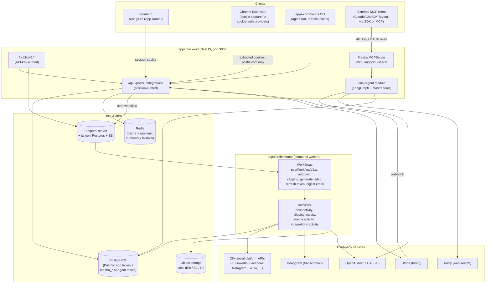

# Postiz Architecture — 2026-10-23

Scope note: this doc covers competitive-positioning-adjacent technical architecture, user-action data flow, risks, and a next-build list. Pages/APIs/feature backlog is covered by `PLAN-2026-10-23-DEEP.md` if/when that file exists — it did not exist at the time this was written, so nothing here duplicates it.

## 0. Ground truth on this repo (read, not assumed)

- Fork: `caelum0x/postiz-app` (origin), tracking `gitroomhq/postiz-app` (upstream). AGPL-3.0.
- Monorepo, pnpm workspaces, 5 apps + shared libraries:
  - `apps/backend` — NestJS REST API (port 3000), also boots the Mastra MCP server and Temporal worker in-process (`apps/backend/src/main.ts`).
  - `apps/orchestrator` — NestJS + Temporal worker: all background workflows/activities (posting, autopost, clipping, video, email, token refresh).
  - `apps/frontend` — **Next.js 16** app (App Router), not Vite as `CLAUDE.md` currently states — confirmed by `next.config.js`, `instrumentation.ts`, `sentry.server.config.ts`, and root `package.json` (`"next": "16.3.1"`).
  - `apps/sdk` — thin TypeScript client hard-coded to `https://api.postiz.com` (Postiz Cloud), used for the published npm SDK.
  - `apps/commands` — CLI entry (`main.ts` + `tasks/`: `refresh.tokens`, `agent.run`, `configuration`).
  - `apps/extension` — Chrome extension (manifest-style background script) that extracts auth cookies from logged-in social sites for providers that need cookie-based auth, allow-listed to `localhost` and `*.postiz.com` origins only.
- `libraries/nestjs-libraries` — shared backend code: Prisma database layer, 35+ `integrations/social/*.provider.ts` (one per channel), `chat/` (Mastra-based AI agent + MCP server + MCP OAuth relay), `deepgram/`, `videos/`, `short-linking/`, `services/payment/` (Stripe).
- Database: **PostgreSQL** via **Prisma** (schema at `libraries/nestjs-libraries/src/database/prisma/schema.prisma`, 91 models). Includes the app's own domain tables (Organization, User, Integration, Post, Media, Subscription, Webhooks, Clipping, ...) plus `mastra_*` tables — the AI agent/MCP framework (Mastra) persists its own state (threads, messages, MCP server/client registrations, workflows) directly in the same Postgres instance (`libraries/nestjs-libraries/src/chat/mastra.store.ts`).
- Queue/orchestration: **Temporal** (`@temporalio/*`, `nestjs-temporal-core`), with its own Postgres + Elasticsearch stack in `docker-compose.yaml` (`temporal-postgresql`, `temporal-elasticsearch`, `temporal`, `temporal-ui`). This replaced a simpler queue — there is no BullMQ in the current flow.
- Cache: **Redis** (`ioredis`), falls back to an in-memory `MockRedis` if `REDIS_URL` is unset (`libraries/nestjs-libraries/src/redis/redis.service.ts`). Used for rate-limiting (`ThrottlerBehindProxyGuard`) and caching, not as the job queue.
- Storage: pluggable — local disk, Cloudflare R2, or S3-compatible (`STORAGE_PROVIDER` env var; `@aws-sdk/client-s3` + `UPLOAD_DIRECTORY`).
- AI stack: LangGraph (`@langchain/langgraph`, `@langchain/openai`, `@langchain/tavily`) for the content-generation agent graph (`libraries/nestjs-libraries/src/agent`), and **Mastra** (`@mastra/core`, `@mastra/mcp`, `@mastra/pg`) for the chat/tool-calling layer that backs both the in-app chat UI and the external MCP server (`/mcp`, `/mcp/:id`, `/sse/:id` routes, started from `start.mcp.ts`).
- Payments: Stripe (`services/payment/`), webhook-driven subscription sync.
- Public API: `apps/backend/src/public-api` — `/public/v1/*` routes, API-key authenticated, rate-limited distinctly from session routes. This is what the published SDK and MCP server call into.

## 1. Deployment reality (do not assume Oracle hosting applies here)

- There is **no live Postiz deployment** on any of the three portfolio boxes right now (confirmed in this repo's own `NOTES.md`: not running on `railyard-box`, `box` 130.61.180.42 currently refuses SSH, `recoder-micro` rejects the shared deploy key). This product has zero live users today — it exists only as code + a `docker-compose.yaml` for local/self-hosted use.
- Self-hosting is the only supported open-source deployment path: `docker-compose.yaml` ships `postiz` (backend+frontend combined container, port 4007), `postiz-postgres`, `postiz-redis`, the full Temporal stack (`temporal`, `temporal-postgresql`, `temporal-elasticsearch`, `temporal-ui`), and optional `spotlight` (Sentry-compatible local error capture). `railway.toml` and the README's deploy table (Docker / Coolify / Railway / any VPS) confirm self-host, not a managed Cloudflare/Oracle target.
- **Postiz Cloud** (`postiz.com`, what `apps/sdk` talks to) is a separately-hosted commercial SaaS *not present in this repo* — it is the thing this OSS edition is positioned against/alongside, not something deployed from here.
- Net: the correct hosting target for this product, if the owner wants it live, is a self-hosted Docker Compose stack on one of the Oracle boxes (recommended: `box` once SSH is restored, given it's the general-purpose box) — not Cloudflare Workers/Pages (no edge-compatible target exists here; Temporal workers and a Postgres-backed Nest app don't fit the Workers runtime model).

## 2. System diagram (real components only)

## 3. Data-flow for the 2-3 most important user actions

### A. Schedule and publish a post (core product loop)
1. User composes a post in the Next.js frontend; frontend calls `POST /posts` (or the public `/public/v1/posts` if driven via SDK/MCP/CLI) with content + target integrations + send time.
2. `PostsController.createPost` (DTO-validated) calls `PostsService.createPost`, which writes `Post` + per-channel settings rows via Prisma to Postgres (one write, no raw SQL per project convention).
3. `PostsService.startWorkflow` first lists/terminates any existing running Temporal workflow for that `postId` (idempotency guard), then starts `postWorkflowV1.1.3` (versioned — workflow code is never mutated in place; new behavior ships as a new version, see CLAUDE.md rule) on Temporal's `main` task queue, tagged with `postId`/`organizationId` search attributes.
4. Temporal dispatches the workflow to the `apps/orchestrator` worker process. The workflow sleeps until the scheduled time, re-checks post state (to catch a cancel/edit during the sleep), then calls `post.activity` → the relevant `integrations/social/*.provider.ts` implementation, which calls the real platform API (X, LinkedIn, etc.) using stored OAuth tokens.
5. Activity result (success/failure, remote post id) is written back to the `Post`/`Integration` rows in Postgres; failures retry per-activity with backoff (non-retryable reasons — e.g. revoked token — short-circuit).
6. Frontend polls/SWR-refetches post status from Postgres via the backend API.

### B. AI chat / MCP-driven content generation (agent surface)
1. A request arrives either via the in-app chat UI (session-authed, hits `Chat` module) or an external MCP client (Claude Desktop, ChatGPT app, or any MCP-compatible agent) calling the Mastra `MCPServer` at `/mcp` (or `/mcp/:id` for a specific self-hosted-instance relay, or `/sse/:id` for SSE transport), authenticated via an API key or the `/mcp-oauth*` OAuth relay (`mcp.relay.service.ts`, `oauth-middleware.ts`) for multi-tenant/self-hosted setups.
2. Mastra resolves the caller's org/auth context (`auth.context.ts`, `async.storage.ts`) and exposes a fixed toolset (`chat/tools/*.tool.ts`: list integrations, generate image, upload from URL, delete post, check video status, trigger integration, etc.) plus the LangGraph agent for free-text generation (web search via Tavily, image gen via OpenAI DALL-E).
3. Tool calls that mutate state (e.g. create/delete a post, trigger an integration) go through the same `PostsService`/`IntegrationService` Prisma-backed code path as the UI — no separate write path — landing in the same Postgres tables.
4. Mastra persists its own conversation/thread/tool-call state in the `mastra_*` Postgres tables (same database, separate tables) so a chat session survives a backend restart.
5. Any action that needs background work (video generation, clipping) hands off to Temporal exactly like path A, rather than blocking the MCP response.

### C. Long-video-to-clips pipeline (Deepgram clipping — the feature with no direct competitor equivalent per the strategy doc)
1. User submits a source video URL/upload; `ClippingService.submitAnalyse` creates a `Clipping` record and calls the `clipping.workflow` on Temporal.
2. Workflow step 1 (`submitClippingAnalyse`/`checkClippingAnalyse`): analysis job submitted to an external job runner and polled (bounded retries, each poll idempotent).
3. Workflow step 2 (`transcribeClipping`): Deepgram transcribes the audio (`deepgram.service.ts`).
4. Workflow step 3 (`pickClippingClips`): an AI call (OpenAI, via the same agent infra) scores the transcript and picks clip boundaries; result written to `ClippingClip` rows.
5. Workflow step 4, per clip: `submitClipFetch`/`checkClipFetch` then `submitClipRender`/`checkClipRender` — fetch the source segment and render the final clip (burned-in captions via `captionClip`), stored to the configured object storage backend.
6. `createClippingDrafts` turns finished clips into draft `Post` rows so the user schedules/publishes them through the normal path A loop — the clipping pipeline is a *producer* of posts, not a separate publishing path.
7. Failure handling is deliberately asymmetric: submission steps tolerate at-least-once (a duplicate job just costs a second render), AI/transcription steps are cheap to retry, and only the final terminal failure (`failClipping`) surfaces to the user.

## 4. Real architectural risks / bottlenecks at current scale (zero live users, zero budget)

- **Not deployed anywhere — the biggest risk is literally "it doesn't run."** All competitive positioning in `STRATEGY-2026-10-23.md` is moot until a live instance exists for a self-hoster to even evaluate, let alone for the growth moves (comparison pages, clipping landing page) to point at a working demo/signup.
- **Three stateful backing services for one app** (Postiz's own Postgres, Temporal's own Postgres, Temporal's own Elasticsearch) plus Redis — a fourth Postgres-class dependency (Elasticsearch) purely so Temporal UI can do visibility search. On a zero-budget single small VPS/Oracle box this is a meaningful memory/CPU footprint (ES alone typically wants 512MB+ heap, already reflected in the compose file's `ES_JAVA_OPTS=-Xms256m -Xmx256m` ceiling) for a product with no users yet. Worth evaluating whether Temporal's SQL-only visibility (no ES) is enough at this scale, dropping the ES container entirely.
- **Single shared Postgres for app data and AI-agent (Mastra) state.** Convenient operationally (one DB to back up), but couples chat/agent load (threads, tool-call logs, MCP registrations) to core posting-data performance and backup size as usage grows — no isolation today.
- **OAuth app setup is the activation cliff**, confirmed by the strategy doc's own top growth move: every self-hoster must register their own developer app per social platform (Meta/TikTok/YouTube approval can take weeks per the README's own comparison table). This is a product-structural bottleneck, not a hosting one — a feature gap, not infra.
- **Self-host-only in practice right now**: no managed hosting exists for this fork (Postiz Cloud at postiz.com is a different, separately-run codebase/infra this repo doesn't touch), so every prospective user must run Docker Compose with 7+ containers themselves — a steep floor for the "technical solo marketer" persona the strategy doc targets, some of whom are not comfortable operating Temporal/Elasticsearch.
- **Cookie-based extension auth is inherently fragile**: providers relying on the Chrome extension's cookie capture (vs. OAuth) break whenever the target platform changes its cookie names/session model, and only work for users running the extension on a logged-in browser — not something a CI/server environment can do.
- **Versioned-workflow discipline is a real but easy-to-violate constraint**: the `post.workflow.v1.x.ts` ladder (14 versions already) means every behavior change to the publish flow adds a new file rather than editing in place — correct for Temporal determinism, but it is pure accretion with no visible deprecation/cleanup path for old versions once no running executions reference them.

## 5. Prioritized next-build list (effort vs. impact)

1. **Get one instance live on an Oracle box (box, once SSH access is restored) — lowest effort, highest impact.** `docker-compose.yaml` already defines the full stack; this is an infra/ops task (bring up containers, point a subdomain at port 4007, set real env vars), not a code change. Nothing else on this list, or in the strategy doc's growth moves, matters while zero instances are reachable.
2. **Guided OAuth-app pre-registration wizard** (strategy doc's own #1 growth move, and this doc's #1 architectural risk). Medium effort: extend the existing `apps/commands` CLI/`configuration.ts` task with a step-by-step per-provider wizard (pre-filled redirect URIs, direct links to each platform's developer console, validation against `missing-env-vars.standalone.spec.ts`'s existing checks) rather than a hosted-credentials fallback, which would require Postiz to hold shared app secrets — a bigger trust/ops commitment for a zero-budget operation.
3. **Drop or make-optional the Elasticsearch dependency in `docker-compose.yaml`** for the self-host default path. Low effort (Temporal supports SQL-only visibility), direct reliability/resource win for the exact persona (small VPS, zero budget) this product targets — makes self-hosting materially lighter before pushing anyone to try it.
4. **Standalone landing page for the Deepgram clipping pipeline** (strategy doc's #3 growth move) — this is a content/marketing build, not an architecture change, but it depends on #1 (a live instance to demo/sign up through) and is the one feature with zero named-competitor equivalent, so it is the highest-leverage SEO/positioning asset once something is live.
5. **Add a lightweight cleanup/documentation pass over the `post-workflows` version ladder** — low urgency, but before adding a 15th version, worth confirming (via Temporal's visibility query) which old versions have zero running executions and can be safely archived, so the versioning discipline doesn't silently become unbounded technical debt.
